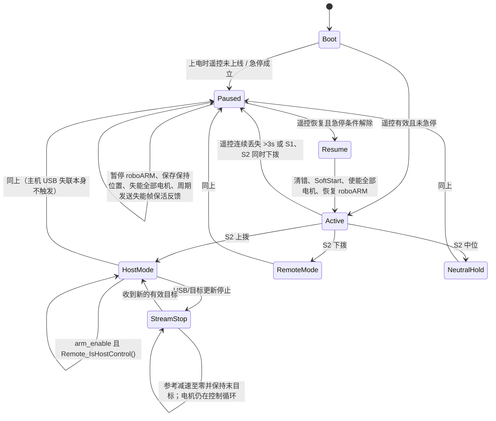

# P4c 机械臂控制安全与异常处置审计

**状态：审计完成、整改待办。未实施生产代码或固件修复；不是“安全验收通过”。**
基线：`p4b/arm-joint-mapping`，`9d48d5d`。审计分支：`p4c/arm-control-safety`。
范围：ThinkBook 上位机源码及 Mac 提供的 `lunar_rover.zip` 中 STM32 源码。没有连接任何硬件。

## 当前实际状态机

`Active/Paused` 是固件 `Error_tasks` 的两态生命周期状态；`HostMode/RemoteMode/NeutralHold` 是控制器 S2 拨杆模式。STM32 的主机 USB 在线超时不是该状态机的转移条件。另一个关键事实是 `Remote_IsHostControl()` 只读取最近保存的 S2 值、不检查遥控是否仍在线；遥控失联后 S2 可保持在“上拨”。

## 风险与证据

| 严重度 | 场景 / 当前行为 | 证据与影响 |
|---|---|---|
| **高，首测阻塞** | 单电机反馈停更或报故障不会使关节转为未初始化。`inited` 首次反馈后置真且没有复位路径；电机错误只解码，`rx_cnt` 未用于超时判断；控制循环继续用缓存的位置/速度计算并发送 MIT 指令。整臂 `inited` 反馈也只是六个锁存布尔值的 AND。 | `lunar_rover/others/src/obj/roboarm.cpp:12–32,475–537`；`lunar_rover/others/src/app/Host.cpp:202–210`；`lunar_rover/others/src/obj/motor_dm.cpp:8–18`；`lunar_rover/others/inc/obj/motor_dm.hpp:65–77`。可能让规划/姿态估计基于过期关节状态继续运行。尚未用真实 CAN 故障复现。 |
| **高，首测阻塞** | 主机 USB 断线、上位机崩溃不会触发 MCU 的保持/失能状态机。固件 `Host_IsOnline()` 仅是 500 ms 遥测判据，没有被安全任务调用。若已处于流式位置模式，目标停止变化后固件会把流速度目标收敛到 0，再在最后目标处保持；电机控制仍在运行。 | `lunar_rover/others/inc/app/Host.h:39–40`；`lunar_rover/others/src/app/Host.cpp:450–457`；`lunar_rover/others/inc/obj/roboarm.hpp:53–62`；`lunar_rover/others/src/obj/roboarm.cpp:227–251,475–537`。保持可能减少下坠风险，但真实负载、温升和驱动器行为未验证；不能把它当作硬件急停。 |
| **高，已复现** | ROS 指令时间戳过期仍被接受；收到越界/非法新命令只记录并返回，不撤销旧有效命令。 | `src/serial/driver/src/node.cpp:239–280` 未检查 `msg.header.stamp`；`299–364` 按 `have_arm_command_` 持续置使能和发送；状态在 `node.hpp:61–80` 中持续保存。隔离 PTY 测试将时间戳设为 ROS 秒 1，证明目标进入 46 字节控制帧；随后发送 100 rad 越界目标，旧目标仍以使能位 1 持续发送。 |
| **高，源码已确认、未动态断线复现** | 串口重连后继续发送断线前缓存的命令。重连只重置反馈分帧器和反馈序号，不清 `have_arm_command_`、关节目标或夹爪目标；重连后的周期包可被固件立即采纳。 | `src/serial/driver/src/node.cpp:524–564`，持久状态见 `node.hpp:61–80`；固件采纳条件见 `lunar_rover/others/src/app/Host.cpp:376–389,440–446`。若 S2 仍在上拨，可能在重连后恢复旧轨迹。 |
| **高** | 急停/遥控失联暂停会失能全部 7 个电机；代码没有针对重力负载区分安全保持与失能。恢复条件消失后约 10 ms 轮询自动清错、重新规划/使能并恢复，没有单独人工确认步骤。 | `lunar_rover/others/src/thread/task_error.cpp:26–43,67–94,96–133`；保持点与缓启动在 `lunar_rover/others/src/obj/roboarm.cpp:108–147`。这可能导致失能时下坠，也可能恢复后回到保存位置；必须先在机械支撑和现场急停方案下确定策略，不能仅凭源码断言安全。 |
| **高** | 遥控失联满 3 秒会暂停，但如果最后 S2 为上拨，Host 接收任务仍只检查 `Remote_IsHostControl()`，不检查 `Remote_IsOnline()` 或 `Remote_IsHoldRequested()`。主机帧可在 `Paused` 期间更新待处理目标；遥控恢复后自动 Resume，之后的新主机帧可能重新驱动旧目标。 | `lunar_rover/others/src/app/Remote.c:149–170`；`lunar_rover/others/src/app/Host.cpp:440–446`；Resume 顺序 `task_error.cpp:118–131`。这是控制权/恢复互锁缺口，尚未在仿真中联调复现。 |
| **中** | STM32 下行虽有序号字段，上位机每帧递增，但固件没有检查它；只校验帧头、同步字、帧尾和有限数值。有限但超限的固件目标由关节软件限位钳制，上位机则先拒绝超限 ROS 命令。 | `src/serial/driver/src/node.cpp:249–258`；`lunar_rover/others/src/app/Host.cpp:351–390,413–446`；`roboarm.cpp:35–41,345–359`。旧帧/重复帧不被固件识别为过期。 |
| **中** | 上位机反馈端能过滤无效帧、非有限值、重复序号并报告序号缺口；但没有反馈静默超时或每关节新鲜度。超 URDF 范围仅警告，仍发布；无新帧时 topic 停发，没有“状态已过期”消息。 | `src/serial/driver/src/node.cpp:392–502`。单轴反馈失联还会被固件打包成“整帧有效”的旧缓存值，见第一行。 |
| **中** | 电机 `error` 字段已解码但未用于停止/故障状态；`rx_cnt` 有计数但没有被周期比较。 | `lunar_rover/others/src/obj/motor_dm.cpp:8–18`；`motor_dm.hpp:65–77`。CAN 总线级错误计数存在，但未见其驱动机械臂故障转移。 |

## 离线复现与测试

1. **ROS 上位机 PTY 故障注入：通过，4 项。** 新建 `/dev/pts/*` 伪串口，运行 P4b 已构建的 `rm_serial_driver`，ROS 域隔离为 `187`；未打开物理串口。验证启动时未收有效关节命令则 `arm_command_enabled=0`；过期时间戳命令被接受；越界命令被拒后旧有效目标与使能位保留；ROS 命令静默期间串口仍持续发送相同目标且序号递增。
2. **STM32 关节流失联模型：通过。** 从 zip 安全提取现有 `tests/joint_stream_test.cpp` 与所需源码/桩，在 ThinkBook 用 `g++ -std=c++17 -O2 -Wall -Wextra -Werror` 编译实际 `roboarm.cpp` 后运行。停流 10 秒后参考位置 `0.999999`（目标 `1.000000`），速度 `0`；流式、阶跃、恢复及六轴限位测试均通过。这证明规划参考能平滑停住，不证明电机能托住实物负载。
3. **未做的注入：** 未物理拔插 USB、未杀死真实 ROS 服务、未模拟 FDCAN 单电机掉线、遥控器丢失/急停与 Resume 联动，也没有执行任何电机指令。相关行为由源码路径确认，实机效果未验证。

复现脚本：`src/serial/driver/test/test_p4c_control_safety.py`。运行前 source ROS Humble 与 `/tmp/robot_p4b_build/install/setup.bash`，设置 `ROS_DOMAIN_ID=187`，然后执行脚本。固件流失测试可参考 zip 内 `lunar_rover/tests/run_stream_tests.ps1` 的 g++ 参数和 `joint_stream_test.cpp`；测试过程仅使用主机桩。

## 整改建议（本轮未实施）

1. **先定义安全停机分层**：主机命令超时后停止接受新目标，让固件按已验证的减速度停稳并保持；是否失能必须由机械臂姿态、负载、制动/支撑能力和独立急停路径决定。不要直接把“拔线”映射成电机立即失能。
2. 为 ROS 命令加入时间戳/单调时钟新鲜度与命令源健康检查；过期、非法或上游失联时进入显式暂停/保持状态，不能无期限继续发布最后轨迹。明确旧目标是否作废。
3. 固件侧增加独立的主机在线失联策略和“暂停期间不采纳 Host 帧”互锁；S2 控制权判断需同时考虑遥控在线与生命周期状态。恢复必须清空待处理历史目标并要求明确重新使能/确认。
4. 为每个电机反馈增加新鲜度与错误状态监测；任一轴失联/异常时阻止基于陈旧状态继续规划，并定义其余轴如何保持。协议应提供可判定的轴状态或心跳。
5. 进行受控单关节试验前，用机械支撑/防坠和现场物理急停验证“受控减速保持”与“失能”两种结果；先固定其他关节，核对方向、限位、负载和恢复流程。

## 首次受控单关节测试前的硬性阻塞项

- 有可验证的每关节反馈新鲜度/故障门控，至少能发现单电机不更新，而不是只看整帧 `inited`。
- 明确并经现场支撑/负载验证的 USB/ROS 失联、遥控急停和恢复策略；不得依赖未验证的“保持”或立即失能。
- 阻止过期命令、串口重连缓存命令及遥控失联期间排队的目标在恢复后自动执行；需要显式清除与重新使能。
- 完成带防坠、可触达物理急停、低风险姿态和监督人员的单轴测试方案，并确认急停本身不会使机械臂坠落。

上述项目完成并通过独立复核前，不建议进入任何真实机械臂运动测试。本轮无生产修复，分支只提交测试代码和本报告。
