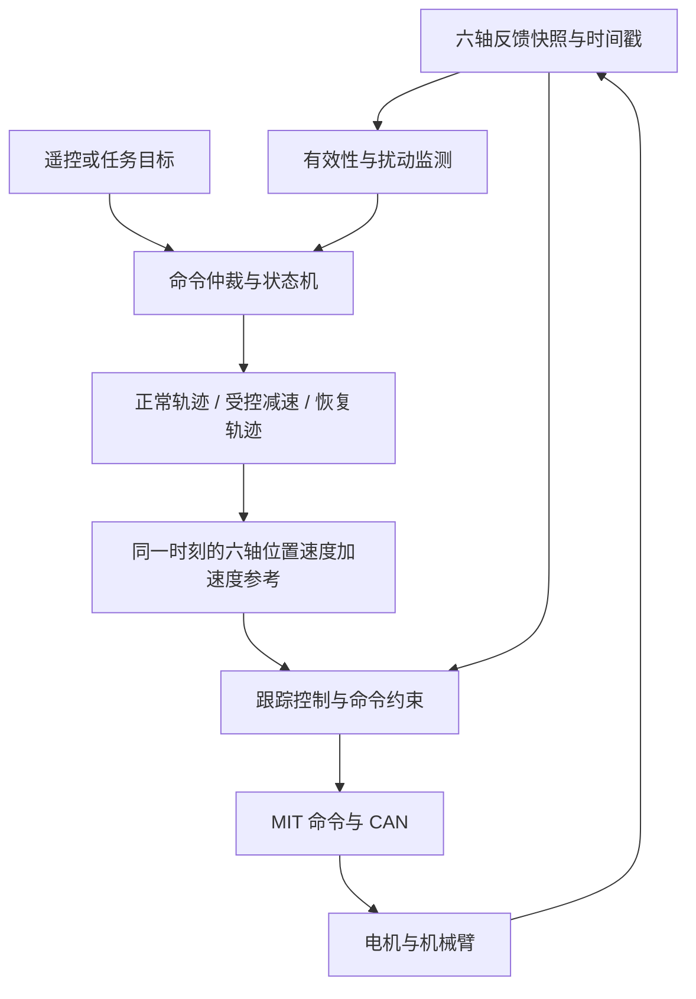

# 六轴机械臂简易路径规划与抗扰动教学

适用工程：`lunar_rover`，STM32H723、FreeRTOS、达妙电机、FDCAN3。依据：2026-09-20 工作区中的源码，包括尚未提交的修改。本文提供教学与实现设计；文中的新增接口和控制策略尚未接入固件，也未经实机验证。

学习目标：能计算一条六轴同步的关节轨迹，理解它如何接入本工程，并设计“检测扰动—减速或柔顺—稳定—恢复任务”的闭环流程。

**核心结论：平滑规划减少机械臂自身运动造成的冲击，并为反馈控制保留力矩余量；外界冲击发生时，反馈控制与阻尼承担即时响应，规划负责调整后续运动和恢复任务。仅增加一条平滑轨迹，不能让机械臂自动抵抗未知冲击。**

## 1. 先分清路径、轨迹和控制

假设机械臂要把物体从 A 搬到 B。

| 层次 | 解决的问题 | 示例 |
|---|---|---|
| 路径规划 | 经过哪些姿态、从哪里绕行 | A → 抬高 → 移到 B 上方 → B |
| 轨迹规划 | 每一时刻应在哪里、运动多快 | 2 秒完成，起止速度为零 |
| 跟踪控制 | 实际位置偏离目标后如何纠正 | 根据编码器误差调节速度和力矩 |
| 扰动处理 | 被推、碰撞、负载改变后怎么办 | 减速、阻尼保持、柔顺退让、恢复 |

六轴关节角表示为：

\[
\mathbf q=[q_1,q_2,q_3,q_4,q_5,q_6]^T
\]

轨迹生成器输出三组量：位置 \(\mathbf q_d(t)\)、速度 \(\dot{\mathbf q}_d(t)\)、加速度 \(\ddot{\mathbf q}_d(t)\)。角度用 rad，角速度用 rad/s，加速度用 rad/s²，时间用 s。

“所有关节一起动”不等于“末端走直线”。关节空间中的直线，经过非线性运动学映射后，通常是末端空间中的曲线。

## 2. 你的工程已经具备什么

以下链接相对于本文所在的 `docs` 目录；表中的函数名便于在编辑器中定位。

| 源文件与入口 | 当前真实行为 | 对规划的意义 |
|---|---|---|
| [variables.cpp](../others/src/thread/variables.cpp)，`j1_left`～`j7_left` | 定义七个 `Joint` 对象、限位、零偏、电机量程和控制参数 | 规划前先明确参与规划的轴 |
| [Remote.c](../others/src/app/Remote.c)，`Remote_UpdateJointTarget()` | 遥控主要给 j1～j6 累加目标角度 | 当前输入是逐轴目标增量 |
| [roboarm.cpp](../others/src/obj/roboarm.cpp)，`UpdateFeedback()` | 接收反馈，展开连续角，计算 `angle.theta` | 可以提供规划起点和闭环反馈 |
| 同上，`StepTarget()`、`SetTarget()` | 累加/设置位置目标，处理圈次和限位 | 尚不能传入速度、加速度参考 |
| 同上，`ControlStep()` | 三次多项式规划 → 位置环 PID 纠偏速度 + 规划速度前馈 → MIT 命令 | 需要在此区分手动目标与规划轨迹 |
| [pid.hpp](../others/inc/algorithm/pid.hpp)，`pid_pos_s` | 误差 PID，带速度及输出变化率限制；当前各轴 `ki=0` | 有基础跟踪能力，但没有显式轨迹速度前馈 |
| [roboarm_kinematics.cpp](../others/src/obj/roboarm_kinematics.cpp)，`Solve()`、`GravityCompensation()` | 求连杆方向，用粗略杆件模型计算 `tg`；`GetEndPose()`/`SolveInverse()` 已预留接口但为存根 | 有简化重力前馈，尚无完整末端位姿、IK、雅可比实现 |
| [task_robo_arm.cpp](../others/src/thread/task_robo_arm.cpp)，`roboARM_task()` | 循环更新运动学，分两组下发电机命令 | 可作为轨迹采样与状态机执行入口 |
| [motor_dm.cpp](../others/src/obj/motor_dm.cpp)，`UpdateFeedback()`、`Ctrl()` | 解码位置、速度、力矩、温度、状态，打包 MIT 命令 | 具备扰动监测所需的部分信号 |
| [task_error.cpp](../others/src/thread/task_error.cpp)，`Error_tasks()` | 遥控丢失/急停时挂起控制任务并失能，恢复时清错、缓启动、使能、恢复 | 需要补充恢复前的状态与参考重置 |

### 2.1 六轴教学与七个电机对象的关系

本文用 **j1～j6 作为六轴规划对象**。`Joint_N::dof = 7`，第七个对象也是 `Joint`，因此不应假定 j7 就是夹爪；它的机械用途需要自行确认。

j7 当前位置 PID 增益、MIT `kp/kd` 和 `kq_vel` 都为零；循环仍会调用 `j7_left.ControlStep()`，而未初始化的 `ControlStep()` 又会发送使能命令，挂起/解挂起流程也会使能 j7。因此不能把它当作已可靠禁用的轴。实际接入前需要明确其机械用途和控制状态；若是第七个机械臂关节，应扩展为七轴规划并更新几何模型。

### 2.2 规划角度不能直接混用

工程使用以下关系：

\[
\theta_i=\text{theta\_offset}_i+\text{pos\_unwrapped}_i-\text{offset}_i
\]

`angle.theta` 是参与运动学的角度；现有位置环比较的是 `pos_ref` 与编码器连续角 `pos_unwrapped`。若规划器输出运动学角 \(\theta_d\)，需要转换：

\[
q_{\mathrm{enc},d}=\theta_d-\text{theta\_offset}+\text{offset}
\]

入门阶段建议轨迹统一使用**编码器连续角坐标**，把零偏转换集中在运动学接口中。这里沿用现有代码的方向和比例约定；若实物还存在减速比或方向映射，应先统一这些约定。

`SetTarget()` 会用 `UnwrapRadNear()` 选择靠近当前位置的等效角。规划一旦选定连续角分支，就不应每周期重新选择“最近的一圈”。对于有机械止挡或线缆限制的轴，最短角度差也未必是合法路径。

例如 j2 限位在源码中约为 `[1.75, 3.883]`，目标却可以写作 `-2.8`，这是圈次对齐后的表示，不宜直接拿原始数值比较。应在规划开始时把起点、终点和物理限位统一到同一固定连续角区间，再验证整段运动。

## 3. 第一课：用关节空间规划完成一次点到点运动

第一版不必先实现 RRT 或复杂避障。先在确认无障碍的工作区，给出已知合法的起点 \(\mathbf q_0\) 和终点 \(\mathbf q_f\)，完成一次平滑运动。

定义路径参数 \(s\in[0,1]\)：

\[
\mathbf q(s)=\mathbf q_0+(\mathbf q_f-\mathbf q_0)s
\]

六轴共享同一个 \(s\)，就能同时开始、同时结束。小位移的轴运动慢一些，大位移的轴运动快一些。

这条路径在关节空间中是直线。若六轴限位都已固定在同一连续角分支，且两端合法，那么这条单调插值路径满足逐轴角度限位；**这不能保证连杆不碰障碍物、没有自碰撞或远离奇异位形。**

### 3.1 为什么推荐五次多项式

| 方法 | 特点 | 初学时的用途 |
|---|---|---|
| 直接跳目标 | 参考位置突变 | 不适合大幅度动作 |
| 匀速位置斜坡 | 限制参考速度，起止速度突变 | 简单手动过渡 |
| 梯形速度 | 有加速、匀速、减速段，加速度切换有跳变 | 常见点到点运动 |
| 五次多项式 | 可令起止速度、加速度均为零 | 本文第一版方案 |
| 限 jerk 的 S 曲线 | 直接约束加速度变化率 | 进一步减小激振 |

五次多项式计算量小，适合 STM32 上固定周期采样。它在连接静止段时能保持位置、速度、加速度连续，但 jerk 仍可能跳变，不能称为完全无冲击。

### 3.2 从边界条件得到公式

令 \(u=t/T\)，其中 \(T>0\) 为总时长。要求：

\[
s(0)=0,\quad s(1)=1,\quad
s'(0)=s'(1)=0,\quad s''(0)=s''(1)=0
\]

得到：

\[
s(u)=10u^3-15u^4+6u^5
\]

\[
\dot{s}(t)=\frac{30u^2-60u^3+30u^4}{T}
\]

\[
\ddot{s}(t)=\frac{60u-180u^2+120u^3}{T^2}
\]

令 \(\Delta q_i=q_{f,i}-q_{0,i}\)，各轴参考为：

\[
q_{d,i}=q_{0,i}+\Delta q_i s,\quad
\dot q_{d,i}=\Delta q_i\dot s,\quad
\ddot q_{d,i}=\Delta q_i\ddot s
\]

执行到 \(t\ge T\) 时固定输出终点、零速度和零加速度。\(\Delta q_i=0\) 的轴保持原位。

### 3.3 总时长如何满足速度和加速度限制

对于上面的零起止速度、零起止加速度五次曲线：

\[
\max|\dot q_i|=1.875\frac{|\Delta q_i|}{T},\qquad
\max|\ddot q_i|=\frac{10\sqrt3}{3}\frac{|\Delta q_i|}{T^2}
\]

因此统一时长应满足：

\[
T\ge\max_i\left(
\frac{1.875|\Delta q_i|}{v_{\max,i}},
\sqrt{\frac{(10\sqrt3/3)|\Delta q_i|}{a_{\max,i}}}
\right)
\]

如果还限制段内 jerk，可再加入：

\[
T\ge\max_i\sqrt[3]{\frac{60|\Delta q_i|}{j_{\max,i}}}
\]

这些是**参考轨迹**的运动学约束，不保证实际电机不饱和，也不保证实际加速度一定等于参考加速度。应留出跟踪纠偏余量，并根据负载验证力矩需求。

### 3.4 一个可手算的六轴例子

以下仅是数学示例，不是本机械臂的实机目标；各轴绝对位置仍需独立验证。

\[
\Delta\mathbf q=[0.4,-0.3,0.2,0.1,-0.2,0.3]\ \mathrm{rad}
\]

假设六轴规划速度上限都为 `0.5 rad/s`，加速度上限都为 `1.0 rad/s²`。最大位移为 `0.4 rad`，所以：

\[
T_v=1.875\times0.4/0.5=1.5\ \mathrm{s}
\]

\[
T_a=\sqrt{5.773503\times0.4/1.0}\approx1.520\ \mathrm{s}
\]

取 `T=2 s`，最大位移轴的参考峰值速度为 `0.375 rad/s`，峰值加速度约为 `0.577 rad/s²`。在 `t=1 s` 时，六轴都完成自身位移的一半。

### 3.5 可独立使用的 C++ 采样核心

下面只实现数学采样，不读取电机、不检查碰撞，也不调用本工程的控制接口。起点和终点均为零速度、零加速度；运动中切换目标不能直接复用这一假设。

```cpp
#include <array>
#include <cmath>

struct Ref6 {
    std::array<float, 6> q{};
    std::array<float, 6> dq{};
    std::array<float, 6> ddq{};
};

bool SampleQuintic6(const std::array<float, 6>& q0,
                    const std::array<float, 6>& qf,
                    float T, float t, Ref6& out)
{
    if (!std::isfinite(T) || !std::isfinite(t) || T <= 0.0f)
        return false;
    for (unsigned i = 0; i < 6; ++i)
        if (!std::isfinite(q0[i]) || !std::isfinite(qf[i]))
            return false;

    Ref6 next{};
    if (t <= 0.0f || t >= T) {
        next.q = (t <= 0.0f) ? q0 : qf;
        out = next;
        return true;
    }
    const float u = t / T;
    const float u2 = u * u;
    const float u3 = u2 * u;
    const float s = u3 * (10.0f + u * (-15.0f + 6.0f * u));
    const float ds = 30.0f * u2 * (1.0f - u) * (1.0f - u) / T;
    const float dds = 60.0f * u * (1.0f - u) * (1.0f - 2.0f*u) / (T*T);
    for (unsigned i = 0; i < 6; ++i) {
        const float delta = qf[i] - q0[i];
        next.q[i] = q0[i] + delta * s;
        next.dq[i] = delta * ds;
        next.ddq[i] = delta * dds;
        if (!std::isfinite(next.q[i]) || !std::isfinite(next.dq[i]) ||
            !std::isfinite(next.ddq[i]))
            return false;
    }
    out = next;
    return true;
}
```

调用返回 `false` 时，应进入明确的异常处理，不能继续把未更新的输出当作有效新轨迹。正常每周期只计算一个采样点，无需在 MCU 中保存整条点列。

## 4. 第二课：路径有多个点，或者要求末端走直线

### 4.1 多个示教点

先记录合法关节姿态 A、B、C，逐段执行 `A→B`、`B→C`。每段使用上面的五次曲线，就会在 B 处停稳，适合“抬起—移动—放下”。

若希望不停顿地经过 B，应为中间点分配一致的速度、加速度，并使用带一般边界条件的多项式或样条。不能把两个都要求停稳的段简单拼接，却期望末端匀速通过。

### 4.2 末端直线运动

末端位置可以写为：

\[
\mathbf p_d(s)=\mathbf p_A+s(\mathbf p_B-\mathbf p_A)
\]

姿态固定，或用四元数 SLERP 插值；不要把欧拉角直接逐项线性插值当作通用姿态规划。对每个采样位姿求逆运动学，再检查关节限位、速度、加速度和碰撞。

实现前需要补齐：完整的关节坐标变换、连杆尺寸、工具坐标、逆运动学和解的连续性选择。相邻点优先使用上一个 IK 解作为初值；求解失败、越界或跳到另一支解时应拒绝该段并重新规划。笛卡尔空间速度平滑也不保证关节速度平滑，接近奇异位形时关节速度可能急剧增大。

本工程 `mdh_left` 中的 `a/d` 当前均为零，`Update()` 只递推旋转；重力计算另用 `kLength` 拼接杆件。现有函数不能直接视作完整末端正运动学。应统一几何模型，并区分 `mdh.axis` 的“连杆方向”与关节旋转轴，再增加 FK、IK 和雅可比。

若需要避障，可以先用经验证的中间点绕行，再考虑搜索算法。只检查末端轨迹不够，所有连杆与工具的扫掠空间都要检查；离散采样还需足够分辨率及几何裕量。

## 5. 为什么规划能够帮助抗扰动

采用以下外力符号约定：

\[
M(q)\ddot q+C(q,\dot q)\dot q+g(q)+\tau_f
=\tau_m+\tau_{ext}
\]

\(\tau_m\) 是驱动器输出的关节力矩，\(\tau_{ext}\) 是外界施加到机械臂上的关节力矩。

### 5.1 先减少自身运动对电机能力的占用

急加速需要较大的惯性力矩。如果原轨迹已经接近电机可用力矩极限，发生扰动时即使位置误差增大，控制器也很难继续增加有效力矩。

规划可以降低速度、加速度和 jerk，或者选择力臂较小、重力负担较轻的姿态，从而为纠偏保留余量。可用以下概念性指标比较候选轨迹：

\[
\rho_i(t)=\tau_{\mathrm{allow},i}(t)-|\tau_{\mathrm{nominal},i}(t)|
\]

其中 `allow` 应考虑电机持续/峰值能力、转速、温度、传动与结构承载能力；`nominal` 应包括重力和运动所需力矩。要求所有轴整段保持正余量，并留出不确定性裕度。它是保守的筛选指标，不是对任意方向外力的抗扰保证。

工程中的 `tg` 可用于第一阶段的慢速静态负载估计，但不能代替完整动力学。`kMass={0,1.2,1.5,0,0.8,0,0}`、`kLength={0,0.320,0.325,0,0.213,0,0}` 是代码中的粗略模型，还假设质心在杆中心；应核实电机、工具及负载是否已计入。

延长运动时间可以降低惯性项，无法消除某个姿态本身过大的重力力矩。若静态重力已超过能力，需改变姿态、负载或机构。

### 5.2 冲击发生时，规划来不及消除全部冲量

对于很短的冲击，可近似理解为：

\[
M(q)\Delta\dot q\approx\int\tau_{ext}\,dt
\]

速度可能在上位规划器完成下一次计算前就发生变化。实际抗冲击能力受机械柔性、减速器、驱动器内环、编码器/CAN 更新、闭环带宽和饱和共同限制。软件中的“500 Hz”不能等同于能抑制所有 500 Hz 以下冲击。

### 5.3 要先选择抗扰目标

| 场景 | 合理目标 | 规划与控制动作 |
|---|---|---|
| 轻微短暂推力 | 尽量保持原轨迹、尽快恢复 | 阻尼反馈纠偏；必要时平滑降低进度 |
| 持续外力 | 避免长期饱和，同时维持任务或有限退让 | 暂停任务推进，保持或进入有边界的柔顺模式 |
| 明显碰撞 | 限制后续施力与损伤 | 根据机构采用受控停止、制动或保护停机 |
| 扰动已消失 | 平稳回到任务 | 重新检查路径，从当前状态生成恢复轨迹 |

“抗扰”可以是小偏差，也可以是低接触力；二者存在取舍。增大刚度通常减小静态偏差，但也可能增加接触力和振荡，不能把所有增益一起调大。

## 6. 结合现有控制器，如何接入规划

### 6.1 当前实际控制链路

`Joint::ControlStep()` 的关键行为可以概括为：

```text
target_pos → 三次多项式规划器 → pos_ref, vel_ref
                                    ↓
e = pos_ref - pos_unwrapped
v_cmd = Limit(vel_ref + pid.Update(pos_ref, pos_unwrapped, vel), pid.cfg.vel_max)
tau_ff = limit(tg + td + kq_vel * (v_cmd - vel))
MIT: pos_des=当前编码角, vel_des=v_cmd, kp=kp_pos, kd=kp_vel
```

`kq_pos`（位置误差→力矩刚度）已于 2026-09-25 删除：位置刚度改由驱动器 MIT `kp`（`kp_pos` 原始 12 位字段）承担——j1/j2/j5 现为 600/500/200，其余轴为 0。力矩字段只保留 `kq_vel`（速度误差→力矩补偿，N·m·s/rad）：j2 = 2.0（≈ MIT kd 的 40%），其余轴 0，用于补"顶满 MIT `kd` 也追不上 `v_cmd`"的关节。它比电机内部 `kd` 多一拍 CAN + 一个任务周期的延迟，增益取大同样会振。

按常见 MIT 控制律理解，电机输出近似为：

\[
\tau_m\approx K_{p,m}(q_{cmd}-q)+K_{d,m}(v_{cmd}-\dot q)+\tau_{ff}
\]

这里的实际增益映射需以电机固件为准。尤其要注意，当前 `Motor_DM::Ctrl()` 接收的 `uint16_t kp/kd` **直接作为 12 位编码字段打包**，不是已经换算好的物理增益。若电机使用注释中的 `kd∈[0,5]` 映射，那么 `4000` 对应约 `4.884`，不能理解为物理阻尼 4000。

`tq_ff` 的限幅目前仅防止力矩前馈字段超出协议量程，**没有限制 MIT 速度误差项与前馈相加后的总电机力矩**。最终还需驱动器电流/力矩限制、命令约束和饱和监测。

### 6.2 别让旧斜坡破坏新轨迹

当前斜坡速度为 `0.8 rad/s`，每次最大步长约为 `0.0016 rad`。虽然注释提到“归位后直接跟随”，实际代码每周期都会重新设置斜坡目标；只要参考与目标相差较大，仍会经过斜坡限制，并没有单独的“归位完成后永久旁路”状态。

若把规划位置逐点塞进 `SetTarget()`，再经过此斜坡，各轴可能发生不同程度的滞后，破坏原定同步关系。推荐明确划分：

- 手动/归位模式：使用既有斜坡，或升级为速度、加速度受限的在线生成器。
- 自动轨迹模式：使用已验证的 `q_d/dq_d/ddq_d`，旁路重复的位置斜坡；保留末级命令限制与状态监测。
- 模式切换：匹配当前参考与实际状态，不能直接跳到另一套参考。

### 6.3 建议增加的接口与模块

以下都是**建议新增**，工程目前没有这些接口。

| 建议位置 | 内容 |
|---|---|
| `others/inc/algorithm/trajectory.hpp` | 六轴轨迹数据、时长计算、五次曲线采样、一般边界条件恢复轨迹 |
| `Joint` | `GetStateSnapshot()`：连续角、速度、力矩、温度、状态、反馈时间戳、有效标志 |
| `Joint` | `SetTrajectoryRef(q,dq,ddq)`：接收已验证参考，明确坐标与模式 |
| `Joint` | 切换模式、受控停止和恢复时重置控制历史的接口 |
| `roboARM_task()` | 同步快照 → 状态监测 → 规划/采样 → 跟踪 → 下发 |
| `Remote.c` 之后的命令仲裁层 | 将遥控意图交给命令仲裁，不与自动轨迹同时改同一目标 |
| CAN 接收/发送层 | 反馈时间戳、过期判断、发送失败计数与处理 |

规划用的 `pos_unwrapped` 是私有成员，`vel/torque/error` 等是基类受保护成员，因此不能直接从任务里假定能读到它们。快照接口应保证一组数据自洽，且记录每轴采样时间；“单个 float 读写原子”不代表六轴和多个字段整体一致。可以采用短临界区、序列号或双缓冲实现，避免在中断里做整条轨迹计算。

建议的任务流程如下。图中“受控减速/恢复”都输出连续参考，并接受限位与状态检查。



### 6.4 跟踪控制应利用轨迹速度

一种适合现有“主机位置环输出速度”结构的改法是：

\[
e=q_d-q,\qquad e_v=\dot q_d-\dot q
\]

\[
v_{raw}=\dot q_d+K_p e+K_v e_v+K_i\int e\,dt
\]

再对总速度命令进行速度和变化率限制，保留经过验证的重力前馈与可选误差力矩项。这里显式的 \(\dot q_d\) 前馈减少“必须先产生位置误差才能运动”的滞后；`K_v` 与驱动器的 MIT 阻尼存在耦合，需重新调参。

`pid_pos_s` 的 D 项使用测得的关节速度：`v_corr = kp*err - kd*feedback_vel`。这样参考位置变化不会产生微分冲击，外部冲击引起的实际速度会形成反向阻尼。切换到该形式后需要重新整定 `kd`，不能沿用旧的误差差分增益；零速度保持时，速度项提供阻尼。

规划速度宜低于最终命令上限，给反馈纠偏留余量；规划加速度上限与速度命令变化率限制也不是同一个物理量。`K_i` **当前未启用**（2026-09-25：全部轴 `ki = 0`，`int_max / sep_pos / sep_vel` 也留 0，控制器等价纯 PD）。不用的原因：静止保持加积分后出现**周期性力矩上下变动**——当时抗饱和写的是"判据不满足就清零"，积分把关节推过 `sep_vel` 就归零、关节退回再累积，形成两态切换（后续试过"冻结 + 0.5 s 泄漏"，仍决定先整体弃用）。因此静止状态的静差目前由 `kp/kd`（速度通道）与驱动器 MIT `kp`（j1/j2/j5 已启用）承担。`pid_pos_s` 里保留了条件积分代码与那段注释，以后若要重开，先读注释里的踩坑记录，且 **不要再用"窗口外清零"**；另外积分带宽只有约 `1/T_i`，对冲击的**瞬态**偏移本来就没有帮助。

### 6.5 固定周期和反馈新鲜度

当前 `ctrl_dt=0.002 s`，但任务循环中是两次 `osDelay(1)`，四轴与后三轴分组发送，中间存在时间偏移；调度、计算和 CAN 排队都会影响实际周期。应测量真实周期、抖动与各轴反馈年龄，采用绝对周期调度或定时触发，并为 CAN 发送安排明确时间预算。

同一轮六轴参考应来自同一轨迹时刻；若按发送时刻分别采样，则需明确时间补偿方式。固定周期算法应与实测周期一致，使用可变 `dt` 的模块则需同步更新积分、微分和限幅计算。轨迹时间不能在任务暂停后直接按旧起始时刻跳到终点。

[bsp_can.cpp](../others/src/bsp/bsp_can.cpp) 的发送失败分支当前为空；电机对象有收发计数，但未见逐轴有效反馈过期后阻止继续控制的完整机制。应先补齐这些基础条件，否则“跟不上轨迹”可能是通信问题而不是外界推力。

## 7. 受扰后如何调整路径和轨迹

### 7.1 第一版先做基于误差的扰动监测

每轴记录：

\[
e_i=q_{d,i}-q_i,\qquad e_{v,i}=\dot q_{d,i}-\dot q_i
\]

可将位置误差、速度误差、反馈力矩和饱和标志组合成状态指标。例如某轴误差持续超过进入阈值，且速度异常或命令持续饱和，则进入减速状态。退出使用更小的阈值，并要求持续稳定一段时间，避免频繁切换。

阈值应由同一负载、姿态和速度下的正常跟踪误差分布确定；近限位、加减速、摩擦和模型误差都会影响它。对严重越界、通信失效、驱动故障应有独立立即处理分支，不能为了去抖延迟所有保护动作。

误差监测只能说明“状态偏离预期”，不能直接判断外力方向，也不能把大误差统一叫作碰撞。

### 7.2 力矩反馈不等于外力传感器

`Motor_DM::Update()` 解码的 `torque` 是电机反馈力矩信号，不是独立测量的末端六维力。按第 5 节的符号约定，若反馈代表关节驱动力矩，可用模型估计：

\[
\hat\tau_{ext}=
\hat M\ddot q+\hat C\dot q+\hat g+\hat\tau_f-\tau_{m,meas}
\]

静止且摩擦影响很小时，可以用 `tg - torque` 的量级作粗略异常线索，但必须校准符号、关节侧换算、反馈含义和模型偏差。它不能直接作为可靠外力输入来做导纳控制。

从速度差分得到加速度会放大噪声；更完整的方案可以研究动量观测器，或增加力/力矩传感器。若已知外力只作用于末端，则有 \(\tau_{ext}=J^T F_{ext}\)；没有有效雅可比、接触位置假设或处在奇异附近时，不能把关节力矩简单转换成末端外力。

### 7.3 平滑减速，而不是突然冻结轨迹时间

若将已生成轨迹写作 \(q_n(\xi)\)，其中 \(\xi\) 是名义轨迹时间，可用进度速度 \(\gamma=\dot\xi\) 控制整体快慢：

\[
\dot q_d=\frac{dq_n}{d\xi}\gamma
\]

\[
\ddot q_d=\frac{d^2q_n}{d\xi^2}\gamma^2+
\frac{dq_n}{d\xi}\dot\gamma
\]

正常 `γ=1`，减速时平滑降到零。不能发现扰动就直接从 `γ=1` 跳到 `γ=0`，否则参考速度出现跳变。加速度约束必须计入 `γ_dot` 项，若要求 jerk 受限，还要约束相应更高阶变化。

这能保持名义几何路径，但并非所有扰动都适合沿原路径继续减速：若检测到新的障碍物，或实际状态已显著偏离原路径，应生成经验证的停止/恢复轨迹。靠近限位时还要考虑停止距离；\(v^2/(2a)\) 只是不含延迟与 jerk 限制的理想估算，实际需额外裕量。

### 7.4 推荐的最小状态机

| 状态 | 行为 | 转移条件 |
|---|---|---|
| INIT | 等待有效反馈，统一角度分支，建立当前参考 | 全部参与轴就绪 |
| TRACK | 同步采样并跟踪任务轨迹 | 扰动指标持续超限 → DECEL |
| DECEL | 保留连续边界状态，生成受约束的减速段 | 速度足够低 → HOLD；异常升级 → FAULT |
| HOLD | 保持选定姿态与阻尼，必要时进入已验证的有限柔顺 | 扰动消失且状态稳定 → REPLAN |
| REPLAN | 检查剩余路径，从当前状态规划恢复段 | 轨迹合法 → TRACK；不可行 → HOLD/FAULT |
| FAULT | 执行该机构定义的保护动作 | 满足重新使能条件后回 INIT |

小扰动不必每次重规划，反馈能够在阈值内消除时可继续 TRACK。保持期间也不要每周期令 `q_hold=q_meas`，否则保持目标不断追随位移，失去恢复原姿态的作用。允许退让时应使用明确的柔顺模型与偏移边界。

当前急停实现会失能电机。对于重力负载，失能可能导致下落，不能把它直接当作通用“抗冲击保持”；受控停止、阻尼保持与失能的选择需结合驱动器能力、机械制动和支撑方式。

### 7.5 恢复轨迹必须保留当前速度

假设机械臂在轨迹中途被推开。直接恢复旧时间进度，会使控制器急着追赶远处的目标；将当前位置强行当作零速度起点，也可能造成参考速度跳变。

若已经停稳，可以用第 3 节的零边界五次曲线，从当前可信位置回到安全的任务连接点。若仍在运动，使用一般边界条件：

\[
q(0)=q_0,\ \dot q(0)=v_0,\ \ddot q(0)=a_0,
\quad q(T)=q_f,\ \dot q(T)=v_f,\ \ddot q(T)=a_f
\]

令 \(q(u)=b_0+b_1u+\cdots+b_5u^5\)，\(u=t/T\)，则：

\[
b_0=q_0,\quad b_1=Tv_0,\quad b_2=\tfrac12T^2a_0
\]

定义剩余边界量：

\[
D=q_f-b_0-b_1-b_2,\quad
V=Tv_f-b_1-2b_2,\quad
A=T^2a_f-2b_2
\]

\[
b_3=10D-4V+\tfrac12A,\quad
b_4=-15D+7V-A,\quad
b_5=6D-3V+\tfrac12A
\]

一般边界曲线可能在起终点之间超调，第 3 节的峰值公式也不再适用。需要重新检查整段角度、速度、加速度、jerk 和碰撞约束；不可行时调整连接点或停止策略，不能只假设加长 T 就必定安全。

初值来自可信状态估计；加速度不能直接用噪声很大的裸差分。若新参考从实测状态开始，与旧参考存在差距，还应设计短暂连续过渡并同步控制器历史，避免模式切换制造额外力矩跳变。

现有 `Error_tasks()` 恢复时仅清错、使能并恢复线程，没有重建 `pos_ref`、斜坡和 PID 历史。加入规划后，应先验证新反馈，取消旧计时与过期任务参考，再经 INIT 建立新轨迹。

## 8. 进阶：冲击时允许小幅退让的阻抗与导纳

### 8.1 关节阻抗：用力矩决定“软硬”

简化关节阻抗形式为：

\[
\tau_{cmd}=\hat g(q)+K(q_d-q)+D(\dot q_d-\dot q)
\]

\(K\) 提供恢复力，\(D\) 提供阻尼。对理想单关节等效惯量 \(J_{eq}\)，可用 \(D\approx2\zeta\sqrt{KJ_{eq}}\) 理解阻尼比与参数关系；这不是本工程可以直接照填的参数，实际还包含电机内环、采样延迟、多轴耦合和饱和。

当前 `tg + td + kq_vel*(v_cmd - vel)` 已具有重力/惯性前馈加阻尼补偿的部分形式，但又叠加了主机位置环产生的速度目标，因此整个系统不能直接等同于上式的单一阻抗控制器。若改成显式阻抗，应重新划分主机与驱动器职责，避免重复刚度、重复速度反馈。

### 8.2 关节导纳：让外力改变参考轨迹

若有可信的外力矩估计，可在名义轨迹上增加柔顺偏移：

\[
M_a\ddot{\delta q}+D_a\dot{\delta q}+K_a\delta q
=\hat\tau_{ext}
\]

\[
q_{ref}=q_{nominal}+\delta q
\]

正向外力矩使偏移沿正向增大，弹簧项在外力消失后将偏移拉回，阻尼项抑制振荡。这里 \(M_a,D_a,K_a\) 是期望的虚拟动力学参数，应为正，并按实际闭环带宽和采样周期设计。

不应仅对最终位置硬截断后继续积分，否则内部偏移状态可能累积。需要同时限制偏移、速度、加速度和总参考，处理边界上的状态回算；检查离散化稳定性以及电机跟踪延迟。偏移后的连杆路径也要重新满足碰撞与限位约束。

对本工程，合理顺序是先实现误差检测、平滑减速、保持和恢复；在力矩模型或传感器可靠后，再增加导纳。没有可信外力输入时，不要直接把 `torque` 填入导纳方程。

### 8.3 如果干扰来自车体振动或倾斜

当前重力计算固定使用基座坐标下 `[0,0,-9.81]`，隐含基座方向不变的假设。若机械臂安装在移动底盘上，底盘倾斜会改变重力在基座系中的方向，基座加速度还会引入额外惯性扰动。

这时需增加基座姿态/运动测量并更新模型；若任务要求末端相对世界稳定，还要补偿基座运动。只有关节编码器、固定方向重力模型和关节轨迹，不能保证末端相对外界保持不动。

## 9. 按这个顺序在工程里落地

| 阶段 | 实施内容 | 判断是否完成 |
|---|---|---|
| 1：基础数据 | 明确六轴与 j7 的职责，核对零偏、方向、固定角度分支、限位、反馈量程 | 状态可解释，手动运动与实际一致 |
| 2：可靠控制入口 | 同步状态快照、时间戳、周期测量、CAN 失败处理、模式仲裁、恢复初始化 | 能区分通信异常与真实跟踪异常 |
| 3：同步点到点 | 五次轨迹、统一时长、轨迹模式旁路旧斜坡、记录参考与反馈 | 六轴参考同步，实际跟踪误差在允许范围内 |
| 4：跟踪改善 | 校准重力模型，加入速度前馈，按模式重整反馈参数和限幅 | 同样任务下滞后减小，无持续饱和 |
| 5：扰动恢复 | 误差监测、DECEL/HOLD/REPLAN、连续切换 | 受扰后没有目标跳变或突然追赶 |
| 6：进阶能力 | FK/IK/雅可比、碰撞几何、可信外力估计、阻抗/导纳 | 按任务指标验证外力响应与恢复 |

新 `.cpp` 文件将来需同时加入 `CMakeLists.txt` 和 Keil 工程；只有头文件的数学模块可先独立验证。不要一开始就把完整 IK、碰撞搜索和轨迹采样全部放进 2 ms 控制循环；较重的规划在低频任务完成，控制任务只消费已验证的轨迹，并核实计算时限和栈空间。

遥控链路也需要处理“目标积压”：当前每约 10 ms 最多累加 `0.01 rad`，相当于名义 `1 rad/s`，而旧参考斜坡约为 `0.8 rad/s`。持续满杆时目标可能走在参考前面，松杆只停止累加，并不保证机械臂立即停止。可把遥控量改为经过加减速限制的速度意图，或限制目标领先量并生成受控停止；自动任务与遥控必须通过同一命令仲裁入口。

## 10. 如何证明方案有效

### 10.1 先验证规划数学

对采样器检查起终点位置、零速度/加速度、正负位移、零位移、统一进度、非法时长，以及整段速度/加速度峰值。一般边界恢复轨迹另检查六个边界条件和中间超调。

本文的 C++ 采样核心已在 PC 上使用 GCC、C++17 编译运行，检查了起终点、中点、零位移、非法时间输入以及 10001 个采样点的位置范围和峰值；算例得到峰值速度 `0.375 rad/s`、峰值加速度约 `0.57735 rad/s²`。一般边界系数也使用非零起止速度、加速度算例核对了终点条件，文档中的本地文件链接已检查。通过这些数学检查只能说明示例与公式一致，不能证明机械臂抗扰能力；尚未执行固件接入或实机验证。

### 10.2 实机记录哪些信号

建议至少记录 `timestamp、mode、q_d、dq_d、ddq_d、q、dq、torque、tg、v_cmd、tau_ff、feedback_age、saturation、CAN_error`。记录实际周期和状态切换时刻，日志通过缓冲低优先级输出，避免高频阻塞打印影响控制。

在低速、轻载、受支撑且限位可靠的条件下，按“无扰动 → 保持时施加小而可控的推力 → 低速运动时施加同类扰动 → 恢复任务”逐步验证。需要比较冲击峰值时应使用外部测量；电机反馈采样率可能漏掉很短的冲击尖峰。

| 比较项 | 指标 | 说明 |
|---|---|---|
| 原斜坡与五次轨迹，无外力 | 跟踪误差、实际振动、峰值驱动力矩 | 判断是否减少自身激振 |
| 相同轨迹、相同可控扰动，不同反馈设置 | 最大偏差、衰减时间、接触力 | 判断反馈与阻尼效果 |
| 相同控制器，开/关扰动恢复策略 | 二次超调、参考连续性、任务恢复时间 | 判断规划恢复是否有效 |
| 不同伸展姿态与负载 | 饱和持续时间、温升、恢复成功率 | 判断力矩余量是否足够 |

“恢复时间”需先定义误差带以及在误差带内连续停留的时间。误差、接触力和任务完成时间应一起比较，避免只追求快速恢复却增大碰撞力。

### 10.3 三个练习

1. 将第 3 节例子的总时长从 `2 s` 改为 `4 s`，计算峰值速度与加速度。答案：最大位移轴分别为 `0.1875 rad/s`、约 `0.1443 rad/s²`。
2. 保持时外力把关节沿正方向推开，为什么恢复力矩应为负？用 `q_d-q` 与 `-D*dq` 的符号解释，并说明为什么电机反馈力矩不能直接当作外力。
3. 当前机械臂以非零速度运动，突然要求暂停，为什么不能直接把下一帧速度置零？分别用进度减速和一般边界五次曲线设计停止思路，并检查停止距离。

完成这些步骤后，工程将从“逐轴目标角跟踪”逐步具备“六轴同步运动、异常识别和连续恢复”的能力。实际可以抵抗多大的外力、承受多强的冲击，仍需由机构、电机、负载和实验共同确定。
