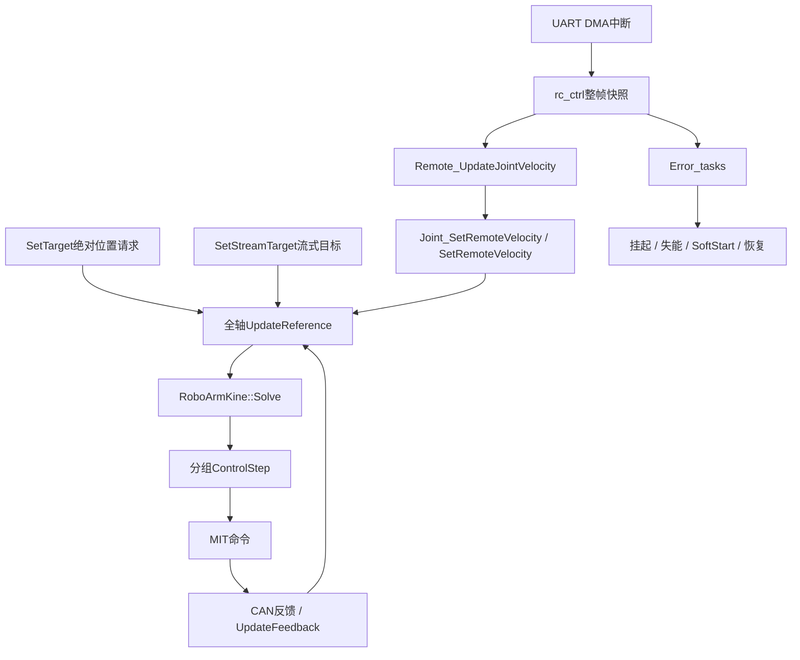

# 调用框架与命名规范

依据：2026-09-26 工作区。遥控已改为速度规划后积分，绝对位置接口保留。完整参数、停止策略和两种方案对比见 [遥控速度规划与位置接口](遥控速度规划与位置接口.md)。

## 1. 分层与数据流



| 层 | 任务 / 入口 | 周期 | 职责 |
|---|---|---|---|
| 输入 | `roboARM_task` → `Remote_UpdateJointVelocity()` → `Joint_SetRemoteVelocity()` | 2ms | 快照、死区、通道→速度；七轴包括零值全部更新 |
| 参考 | 全轴 `Joint::UpdateReference()` | 2ms | 消费位置/流式请求；到点停车三次规划、流式会合式三次规划，或速度S曲线及解析积分 |
| 前馈/输出 | `RoboArmKine::Solve()` → 分组 `Joint::ControlStep()` | 2ms | 本拍参考计算惯性前馈，位置纠偏、MIT输出 |
| 生命周期 | `Error_tasks` → `Joint_CaptureHoldAll()` / `Joint_SoftStartAll()` / enable / disable | 10ms | 失能前保存复位位置，恢复后从反馈规划回保存位置 |
| 反馈 | CAN中断 → `Joint::UpdateFeedback()` | 帧驱动 | 解码、展开连续角，第一帧固定限位圈次 |

遥控接收依靠 UART IDLE+DMA 中断（`HAL_UARTEx_RxEventCallback`），不随控制任务挂起；原本只用于占位的 `RC_task` 槽位已删除，`.ioc` 里不再有 `RC` 任务。位置请求和有效标志用短临界区成对写入/消费；速度命令、规划状态仅由控制任务更新。`SoftStart()` 必须在控制任务已挂起时调用。

## 2. 关节控制链

```text
Remote_UpdateJointVelocity() → 每轴 SetRemoteVelocity(ratio)
全部关节 UpdateReference():
  初始化 → 参考对齐反馈位置；有保存目标时规划返回，无保存目标时就地保持
  SetTarget 请求 → 位置模式: PlanToTarget() + planner.Update(2ms)
                  （终点速度恒 0：到点停车，适合点动/航点/夹爪）
  流式目标 → 同上分支: PlanToStreamTarget() + planner.Update(2ms)
             （终点速度 = 目标自身速度估计：匀速时曲线退化成直线，稳态无滞后）
  速度模式 → velocity_planner.Update(): 限速/限加速度/限jerk → 解析积分
              候选轨迹和制动包络越过限位/跟踪窗口时改为制动
              松杆停稳 → 保存hold_pos，切入固定位置保持
  保持/复位 → 到位后被推远只重建一次起点，保持目标hold_pos不变
              回位中跟踪慢则平滑减慢轨迹时钟，同步换算速度/加速度，不反复清零
  GuardReference → 两模式共同硬限位，裁剪后清除旧规划和纠偏历史
RoboArmKine::Solve() → 本拍 tg/td
分组 ControlStep():
  再取实际反馈 → 实测触限时启用单侧输出保护
  v_corr = pid.Update(pos_ref, pos_unwrapped, vel)
  v_cmd  = Limit(vel_ref + v_corr, pid.cfg.vel_max)
  tq_ff  = Limit(tg + td + kq_vel*(v_cmd - vel), 力矩量程)
  Ctrl(pos, v_cmd, kp_pos, kp_vel, tq_ff)
  触限例外：内部kp/kd归零，速度环作用折算力矩后单侧限制，禁止外向命令
```

全部轴 PID 积分仍关闭。正常运动的增益和 MIT 控制方式保持；实测触限期间使用单侧力矩保护，向内离开退出滞回后恢复原增益。速度模式仍使用位置反馈纠偏。

| 参数 | 位置 | 含义 |
|---|---|---|
| `remote_vel_max_j1..j7` | `variables.cpp` | 满杆角速度 rad/s，保留旧步长换算的有效速度 |
| `pid_cfg` / `kp_pos` / `kp_vel` / `kq_vel` | `pid.hpp` / `variables.cpp` | 反馈及驱动器增益 |
| `plan_time` / `time_min` / `time_max` | `route_planning.hpp` | 保留的绝对位置规划时长参数 |
| `plan_vel_scale` / `plan_accel_scale` | `roboarm.hpp` | 位置规划速度预算 / 两模式加速度预算 |
| `position_accel_fraction` | `roboarm.hpp` | 位置曲线占总加速度预算的比例，余量用于跟踪滞后时的进度调速 |
| `stream_hold_time` / `stream_vel_slew_scale` | `roboarm.hpp` | 流式目标速度估计的停流判据与变化率上限（＝加速度预算的系数倍） |
| `jerk_ramp_time` / `tracking_window` / `limit_margin` | `roboarm.hpp` | 速度模式 jerk、跟踪窗口和限位裕量 |
| `limit_hysteresis` | `roboarm.hpp` | 实测限位输出保护的退出滞回，向内指令即时放行 |
| `RC_CHANNEL_DEADBAND` | `Remote.c` | 2%死区，连续重映射 |

## 3. 命名规范

| 类别 | 规范 | 示例 |
|---|---|---|
| POD 结构体 | `lower_snake_s` | `angle_limit_s`、`param_factor_s`、`cubic_cfg_s` |
| 类 | `PascalCase` | `Joint`、`Motor_DM`、`RoboArmKine`、`Bsp_CAN` |
| 命名空间 | `Xxx_N` | `Joint_N`、`RoboArm_N`、`Route_Plan_N`、`Motor_DM_N` |
| 常量 | `lower_snake`（`inline constexpr`） | `ctrl_dt`、`plan_time`、`jerk_ramp_time` |
| 成员变量 | `lower_snake`（**不加 `m_` 前缀**） | `target_pos`、`pos_ref`、`tx_header` |
| 成员函数 | `PascalCase()` | `ControlStep()`、`Solve()`、`UpdateFeedback()` |
| 函数参数 | 尾部加 `_` | `ratio_`、`data_`、`pose_` |
| C 桥接接口 | `模块_动作()` | `Joint_SetRemoteVelocity()`、`Joint_SoftStartAll()`、`Remote_IsHoldRequested()` |
| 关节数 | 只在 `Joint_N::dof` 定义一次 | 其余文件一律引用它 |

**例外（不可改）**：`StartDefaultTask` / `Error_tasks` / `roboARM_task` 必须与 CubeMX 生成的 `Core/Src/freertos.c` 里的名字一致；`HAL_*Callback` 是 HAL 回调名。

---

## 4. 预留接口（位置已固定，实现为空）

| 接口 | 位置 | 现状 | 实现前必须先解决 |
|---|---|---|---|
| `RoboArmKine::GetEndPose(pose_s&)` | `roboarm_kinematics.hpp/.cpp` | 存根，返回 `false` | `mdh_left` 的 `a/d` 目前全为 0；递推要换成完整变换 `Rot_X·Trans_x·Rot_Z·Trans_z`；缺末端工具坐标 |
| `RoboArmKine::SolveInverse(pose, q_seed, q_out)` | 同上 | 存根，返回 `false` | 依赖正解；还需解支连续性选择、关节限位、奇异检查 |
| `RoboArm_Kine_N::pose_s` | 同上 | 已定义（位置 + 旋转矩阵） | 与工具坐标系的约定需固定 |
| `Joint::SetStreamTarget(float)` | `roboarm.hpp` | 已实现，上位机下行 j1..j6 在用 | 流式目标入口：终点速度取目标自身速度，匀速跟踪无滞后；回归测试 `tests/joint_stream_test.cpp` |
| `Joint::SetTarget(float)` | `roboarm.hpp` | 已实现，上位机下行 j7（夹爪）在用 | 绝对位置入口：到点停车；零遥控不覆盖位置模式，非零遥控主动接管 |
| `others/inc/algorithm/rls.hpp` | —— | 空占位 | 惯量辨识用（见 `docs/五次增量位控与关节惯量辨识.md`） |

**尚未做、但已解码可用的信号**（做保护时直接取用）：

- `Motor_DM::error`（故障码）、`temperature_mos` / `temperature_rotor`（只解码，无人读）；
- `Motor_DM::rx_cnt` / `tx_cnt`（收发计数，可用于反馈超时判据）；
- `Bsp_CAN::error` / `error_count`（错误现场与次数）；`Transmit()` 失败分支仍为空，需要计数上报。

---

## 5. 本次整理记录（删除了什么、为什么）

| 删除项 | 原位置 | 原因 |
|---|---|---|
| `slope.hpp`（整个文件） | `inc/algorithm/` | 已被 `route_planning.hpp` 的三次多项式规划器取代，无任何引用 |
| `Gripper` 类 + `Gripper_N` 命名空间 | `roboarm.hpp/.cpp` | 从未实例化，属于死的功能实现 |
| `RoboArm` 类 | `roboarm.hpp` | 从未实例化，只是 joints+mdh 的搬运壳 |
| `Motor_DM::Ctrl(pos, vel)` / `Ctrl(vel)` | `motor_dm.hpp/.cpp` | pos-vel / vel 协议从不使用（固件只用 MIT + 单字节命令） |
| `Motor_DM::GetParam/SetParam/SaveParam`、`param_index_e`、`param` | `motor_dm.hpp/.cpp` | 电机寄存器读写从不使用；`Update()` 里的参数回帧分支随之删除 |
| `Bsp_CAN::ConfigTDC/Reset/GetRxHeader/GetRxData/GetHandle` | `bsp_can.hpp/.cpp` | 无调用者 |
| `Joint::SetTargetStep/TargetStep()/VelRef()` | `roboarm.hpp/.cpp` | 无调用者的访问器；步长在构造参数里配置 |
| `Joint_N::target_s` | `roboarm.hpp` | 只有 `pos` 一个字段的包装，直接用 `float target_pos` |
| `RoboArm_Kine_N::dof` | `roboarm_kinematics.hpp` | 与 `Joint_N::dof` 重复定义，统一到后者 |

重命名（跨文件同步）：`RoboArmJointAngles` → `RoboArmKine`、`Update()` → `Solve()`、`Joint::LoadTarget()` → `ControlStep()`、`UpdateInfo()` → `UpdateFeedback()`、`FacZoom()` → `MakeFactors()`、成员去 `m_` 前缀。

> MDK 工程文件（`lunar_rover.uvprojx` / `.uvoptx` / `.eide/eide.yml`）里的 `slope.hpp` 条目已同步替换为 `route_planning.hpp`。

---

## 6. 文件地图

| 文件 | 职责 |
|---|---|
| `inc/algorithm/route_planning.hpp` | 绝对位置三次多项式规划 |
| `inc/algorithm/velocity_planning.hpp` | 速度S曲线、解析积分和完整制动位置包络 |
| `inc/algorithm/pid.hpp` | `pid_pos_s` 位置环 + `RoboArm_Pid` 各轴参数 |
| `inc/algorithm/mathetics.hpp` | `Abs/Limit/DeadZone/WrapRad/UnwrapRadNear` 等小工具 |
| `inc/bsp/bsp_can.hpp/.cpp`、`bsp_tim.hpp` | FDCAN 收发与错误现场；DWT 微秒时基 |
| `inc/obj/motor_dm.hpp/.cpp` | 达妙电机：反馈解码、MIT/单字节命令、量程换算 |
| `inc/obj/roboarm.hpp/.cpp` | `Joint` 类：目标、规划、PID、MIT 下发、缓启动 |
| `inc/obj/roboarm_kinematics.hpp/.cpp` | 运动学：连杆方向、重力前馈、（预留 FK/IK） |
| `inc/app/Remote.h`、`src/app/Remote.c` | DBUS 解析、在线/丢失判据、摇杆→比例映射 |
| `inc/app/Host.h`、`src/app/Host.cpp` | 上位机 USB-CDC 协议：同步/校验/拆包/执行目标/组包/发送（`Host_Poll()`） |
| `inc/modules/ring_buffer.hpp` | 无锁 SPSC 环形队列（ISR 写、任务读） |
| `src/thread/variables.cpp` | 全局对象唯一构造处（关节、CAN、运动学、USB 链路变量、C 桥接接口） |
| `src/thread/task_*.cpp` | 任务入口的实现（CubeMX 弱符号的强定义）；只做调度与时序，不放算法 |
| `src/callcallback/can_callback.cpp` | FDCAN 接收/错误回调 → 分发到各关节 |
| `src/callcallback/usb_callback.cpp` | USB 中断钩子 → 搬字节进环形队列 + 置 `HOST_RX_FLAG`，不做帧解析 |

### 一条链路拆成三层放（以 USB 为例）

| 层 | 文件 | 只做 |
|---|---|---|
| 中断回调 | `src/callcallback/usb_callback.cpp` | `Host_UsbReceive()`：搬进环形队列 + `osThreadFlagsSet(HOST_RX_FLAG)` |
| 任务调度 | `src/thread/task_host.cpp` | `Host_Task()`：`MX_USB_DEVICE_Init()` + 等标志 + `Host_Poll()` |
| 协议实现 | `src/app/Host.cpp` + `inc/app/Host.h` | `Host_Poll()`：同步、校验、拆包、执行目标、组包、发送 |
| 全局对象 | `src/thread/variables.cpp` | `host_usb_queue` / `host_link_tick` / `host_rx_frames` / `host_rx_drop` |

约定：

- **任务初始化集中在启动任务**：所有一次性前置初始化都写在 `src/thread/task_start.cpp` 的 `StartDefaultTask()` 里（微秒时基 → FDCAN3 → USB），各任务体不做初始化；新增任务时在该函数的“任务初始化总表”里加一段并注明“谁依赖”。
- 跨文件共享的常量放头文件（如 `HOST_RX_FLAG`），不在两个 `.cpp` 里各写一份字面量。
- 新增/移动源文件必须同步三处构建清单：`CMakeLists.txt` 的 `USER_SOURCES`、`MDK-ARM/lunar_rover.uvprojx` 的分组与头文件列表、`MDK-ARM/.eide/eide.yml` 的 `virtualFolder`。
- 启动任务栈是 `256*4`（必须容纳 USB 初始化调用链，512 B 不够）；改栈要同时改 `lunar_rover.ioc` 的 `FREERTOS.Tasks01`，否则重新生成会被改回去。
