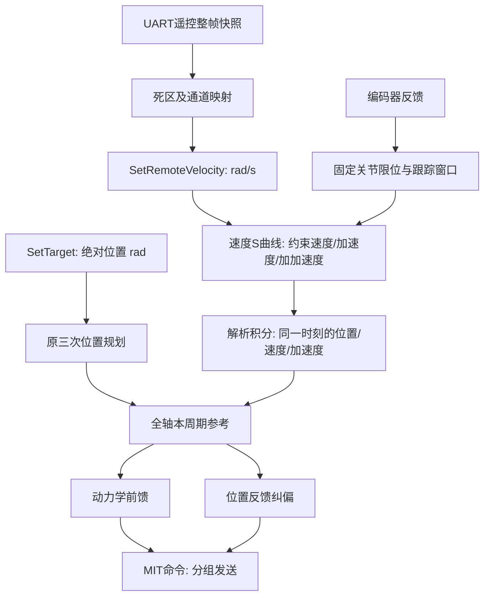

# 遥控速度规划与位置接口

依据：2026-09-26 工作区。遥控使用受速度、加速度、加加速度约束的在线速度规划；`Joint::SetTarget(float)` 保留三次多项式绝对位置规划。下文数值是参考轨迹的限制，不代表电机在所有负载下均能实现同样的运动。

## 1. 当前数据流

每个名义 2ms 周期依次执行：`Remote_UpdateJointVelocity()` → 全轴 `UpdateReference()` → `RoboArmKine::Solve()` → 分组 `ControlStep()`。

遥控 DMA/中断持续收帧，控制任务在短临界区复制整帧。原 `RC_task` 入口已删除（`.ioc` 里的 `RC` 任务连同 `task_rc.cpp` 一起移除），不再另起 10ms 积分时基。控制任务采用绝对截止时间调度；规划积分和 PID 均使用 2ms，超期不补算历史运动，`arm_control_overrun_count` 记录错过周期截止时间的事件。频繁超期会使实际运动速度偏离设定，需上板核查此计数与周期抖动。

动力学前馈现在读取本拍的新速度、新加速度。CAN 四轴/三轴之间仍有约 1ms 发送偏移；这不等于所有电机同时执行命令。

## 2. 输入、模式和停止

- `SetTarget(q)`：单位 rad，绝对位置请求；在下一控制周期对齐编码器圈次、钳制到关节范围并沿用原三次规划到位，终点速度为零。正常运行沿用当前参考位置、速度，回中不会取消该请求。
- `SetVelocity(v)`：单位 rad/s，仅控制任务调用，切入速度模式。终点是所需速度，终点加速度为零；到达后持续匀速积分。`SetVelocity(0)` 受限减速，速度/加速度归零后自动切入固定位置保持，不再反复执行零速度积分。
- `SetRemoteVelocity(ratio)`：遥控专用，按该轴满杆速度定标；非零输入取得遥控控制权。零输入仅停止已由遥控接管的轴，不覆盖显式位置模式。
- 同一周期收到位置请求时，消费该请求进入位置模式；若下一拍摇杆仍非零，遥控会重新接管。应用层应在回中时发起自动定位。
- 原 `StepTarget` / `Joint_StepTarget` / `Remote_UpdateJointTarget` 增量入口已移除。
- S1 中位控制 j1/j2/j3/j4，通道顺序仍是 ch0/ch1/ch3/ch2；S1 上位控制 j5/j6，使用 ch0/ch1，本组空闲的 ch3 分给 j7。七轴至此全部有遥控通道。
- 每拍向全部七轴提交结果，包括零。回中、S2 中位、切到另一关节组或 100ms 未收到有效帧，都撤销相关轴的遥控速度，并开始减速。S2 中位的含义由“冻结累计目标”改为“遥控减速后保持”；它不会取消独立的 `SetTarget` 定位。
- 两个拨杆同时下拨、失联超过 3s，仍由原 `Error_tasks` 挂起控制任务并失能。该急停/失能路径不等同于 S 曲线减速，实际机械运动由驱动器与负载决定。
- 首次上电没有保存目标时，以当前反馈位置保持；构造参数中的旧位置不触发自动归位。正常保持和急停恢复均使用独立保存的 `hold_pos`，不因外力推动而覆盖。
- 挂起执行任务后、失能之前，`Joint_CaptureHoldAll()` 保存一次恢复位置：静止保持或自动复位中保留原保持目标；用户主动运动途中急停则保存触发瞬间的实际位置。`SoftStart()` 只重置规划/PID 历史，恢复时从最新反馈位置限速规划回保存位置，不重放旧速度、不补积分挂起时长。
- 急停/失联恢复后，旧的非零杆量不能立即覆盖复位目标。必须收到有效遥控帧且四个摇杆通道都在死区内，之后新的拨杆运动才重新接管。S2 冻结、未选中轴和遥控超时产生的零指令不能替代真实回中。
- 参考零速度初始化假设恢复时关节已近静止，不能代替实际运动状态检测；位置保存在 RAM，断电后不保留。

保持目标与执行参考分开：`hold_pos` 是需要返回的位置，`target_pos` 是当前可执行段的终点，`pos_ref/vel_ref/acc_ref` 是本拍参考。松杆停稳或显式 `SetTarget` 会更新保持目标；静止时的外力、跟踪窗口及限位裁剪不会改写它。已经到位保持后，被外力推移超过 0.35rad 时重建一次规划起点，再规划回 `hold_pos`。只有参考停在目标且实际反馈回到目标附近后，才重新允许下一次外力偏移重建。回位中暂时跟不上或被持续按住不再反复回拉参考、清零速度和 PID；新手动输入或新的绝对位置命令可以主动改变保持目标。

位置模式通过 `UpdatePositionReference()` 平滑调节三次轨迹的时间进度：跟踪偏差不超过 0.175rad 时正常推进，0.175～0.35rad 之间逐渐降速，达到 0.35rad 时请求暂停，反馈追上后继续同一段轨迹。时间倍率本身有变化率限制，因此这里是软调速阈值，减速过程中偏差可以暂时超过 0.35rad；固定关节限位仍是硬约束。保存目标始终不变，持续受阻不会反复从零加速。

若轨迹时间为 `τ`，时间倍率为 `s=dτ/dt`，输出同步换算为 `v=q′(τ)·s`、`a=q″(τ)·s²+q′(τ)·ds/dt`，动力学前馈使用换算后的速度和加速度。三次曲线使用总加速度预算的一半，另一半留给时间倍率变化；正常可行轨迹的总预算仍为 `PID accel_max × 0.75`。这可能延长加速度受限的位置移动时间；速度模式不变。位置模式仍只保证位置、速度连续，不保证加速度连续或 jerk 有界。

## 3. 速度规划及约束

`velocity_planning.hpp` 使用三段恒 jerk 轨迹：增加/改变加速度、恒加速度、将加速度收回到零。小速度变化时恒加速度段为零。每拍从当前 `(v_ref,a_ref)` 重新求解，因此加速中松杆或反向也保持连续状态。最后一段执行完毕后继续按目标速度积分，不会固定位置同时输出非零速度。

每个恒 jerk 子段使用解析积分，跨段时分段积分：

\[
q_1=q_0+v_0h+\frac12a_0h^2+\frac16jh^3,\quad
v_1=v_0+a_0h+\frac12jh^2,\quad a_1=a_0+jh.
\]

所以没有另外一份 `q_cmd += 原始摇杆速度 × dt` 的累计目标。`target_pos` 在速度模式下只记录当前积分参考。未触发硬限位时，速度模式参考为 C²，jerk 有界但可分段跳变；切入保留的三次位置模式只保证 C¹，加速度可以跳变。已经触限或越界时，参考硬裁剪优先于连续性，不能同时承诺加速度/jerk 仍按普通 S 曲线变化。

每拍先试算候选状态，再计算从候选状态到零速度的完整制动位置包络，包含段内 `v(t)=0` 的位置极值。若下一拍及其制动过程将超出关节范围或反馈跟踪窗口，本拍改为制动，不继续追赶摇杆。关节限位圈次在第一帧反馈确定后固定，不能随积分目标移动到下一圈。

积分前后都执行硬边界检查，且检查本拍段内极值。即使参考已经到达边界且仍有外向速度，也会将参考位置截在边界、速度与加速度归零，禁止继续向外积分。实际反馈突然移动导致跟踪窗口收缩时，参考同样按新窗口裁剪。参考的硬裁剪不代表有惯性的机械臂可以瞬间停住；持续阻挡、反馈超时和驱动故障仍需独立的保护。

`Joint::GuardReference()` 在参考更新前后和最终发送前同时保护两种模式。实测到达边界后，会丢弃外向参考位置差、速度、加速度、原规划以及外向 PID 历史；受阻的本段绝对目标临时截短，但合法的 `hold_pos` 不被删除，保护解除后仍可返回它。速度指令向外时按零处理，向内反拨不等待退出限位保护，即可从约束后的状态重新规划。保存的位置始终经过固定关节范围限幅，不会保留摇杆越界积分形成的欠账。

最终输出使用实际反馈位置判定方向保护，0.001rad 的退出滞回用于避免编码器噪声导致频繁切换。触限期间，向外的纠偏速度和力矩前馈都被截掉，包含向外的重力/惯性补偿。仅裁剪速度指令不能约束 MIT 驱动器内部的阻尼力矩，因此触限期间将内部 `kp/kd` 设为零，将原 `kd × (v_cmd-v_feedback)` 按协议增益折算到力矩字段，再将总力矩限制为向内或零。离开滞回范围后恢复原 MIT 增益。12bit 力矩零附近存在半 LSB 量化误差，编码选择向内的一侧，避免零指令被编码为向外力矩。

上述方向约束保证发送命令不主动顶向已检测到的限位；它依赖现有 MIT 协议的正负方向和 `kd=0..5` 映射。外部负载、驱动器实际响应以及反馈/通信延迟仍须实机验证。

| 参数 | 当前值 | 位置 |
|---|---|---|
| 满杆角速度 j1～j7 | 1.2 / 0.8 / 0.8 / 1.0 / 1.0 / 1.2 / 1.2 rad/s | `variables.cpp` 的 `remote_vel_max_j*` |
| 遥控死区 | 归一化 2%，扣除死区后线性重映射到满量程 | `Remote.c` |
| 参考最大加速度 | 该轴 PID `accel_max × 0.75` | `Joint_N::plan_accel_scale` |
| 位置曲线的加速度预算占比 | 50%，余量用于时间进度调速 | `Joint_N::position_accel_fraction` |
| 速度模式参考最大 jerk | 上述最大加速度 / 0.05s | `Joint_N::jerk_ramp_time` |
| 反馈跟踪窗口 | 速度模式 ±0.35rad；位置模式在半窗口开始软调速 | `Joint_N::tracking_window` |
| 角度限位内预留参考裕量 | 0.002rad | `Joint_N::limit_margin` |
| 实测限位退出滞回 | 0.001rad，向内指令不受等待限制 | `Joint_N::limit_hysteresis` |
| 绝对位置规划速度上限 | 满杆角速度 × 1.8，并受 PID 总速度上限约束 | `Joint_N::plan_vel_scale` |

j6/j7 的旧注释写了 0.8/0.6rad/s，但实际旧配置均为 0.012rad/10ms，本次按实际数值保留 1.2rad/s。跟踪窗口和 jerk 是新增初始整定值；不能把 0.002rad 参考裕量解读为已验证的机械安全距离。

位置模式的目标和每拍采样参考现在也使用相同的硬限位与输出方向保护；裁剪后重建规划，防止下一拍重新输出旧轨迹。原三次规划器仍未做整段位置包络可行性求解，`CubicTimeByLimits()` 的不可行返回语义也未改造；当前保护对采样后的参考和最终输出生效。

## 4. 两种方案的本质差异

方案 A：**先积分原始指令速度，再追踪累计位置目标**。

\[
q_{cmd,k+1}=q_{cmd,k}+v_{stick,k}\Delta t.
\]

这个目标记录操作者累计要求的位移。规划器受限不能立刻跟上时，差额留在目标中。松杆只让目标停止增长，机械臂仍要完成剩余位移。必须另外管理目标超前、饱和和跟踪失败，才能避免持杆期间累积过多运动。

方案 B（现实现）：**先规划可执行的参考速度，再积分该速度**。

\[
(v_{ref},a_{ref})=\mathrm{VelocityPlan}(v_{stick}),\quad
q_{ref}=q_{ref,0}+\int v_{ref}\,dt.
\]

摇杆表达当前希望的速度。加速时未实现的原始指令位移不另记账；松杆就是以当前速度/加速度开始制动。制动完成后的参考位置作为保持目标。这里“可执行”指满足配置的参考运动约束，不代表已经消除电机的实际跟踪误差。

| 比较项 | A：累计指令位置 | B：速度规划后积分 |
|---|---|---|
| 控制语义 | 这段操作累计要求多少位移 | 当前希望以多快的速度运动 |
| 推杆启动 | 目标立即向前，参考受加速度约束跟随 | 参考速度按约束上升，位置与其一致 |
| 松杆 | 停止更新累计目标，继续到该目标 | 从当前参考状态制动，保持停止位置 |
| 换向 | 累计目标可能仍在原方向，存在消化欠账的过程 | 立即改变速度过渡目标，受惯性约束减速再反向 |
| 卡住/负载过大 | 原始积分可持续向前，需要额外抗积累 | 仍可能积累参考与反馈误差，但本实现用制动包络和跟踪窗口约束 |
| 相同“杆量×时间” | 未饱和且最终追踪成功时，累计目标位移确定 | 最终位移取决于加减速、换向和约束介入；某些对称工况可能与 A 相同 |
| 到位精度 | 最终目标明确，适合指定位置 | 停止位置由速度轨迹决定；指定位置使用保留的 `SetTarget` |
| 平滑性 | 取决于位置规划器，原三次为 C¹ | 普通速度 S 曲线为 C²；硬限位介入时优先保证边界 |
| 适合场景 | 累计位移、定点、归位 | 手动遥控、点动、连续速度操纵 |

例如当前参考以 1.2rad/s 匀速运动，最大加速度 12rad/s²、最大 jerk 240rad/s³，松杆后 S 曲线制动总时长为 0.15s，制动距离为 0.09rad（约 5.16°）。这段位移来自减速过程；不是必须补完的原始摇杆累计位移。实际机械臂还可能有反馈跟踪误差，不能据此承诺实机也在同一时刻/位置停止。

## 5. 验证

- `tests/run_motion_tests.ps1`：MinGW gcc/g++ 编译真正的规划器、`Joint` 和 `Remote.c`，只替换 UART/CAN 硬件边界；使用 `-Wall -Wextra -Werror`。
- 规划测试覆盖解析积分、匀速、加速中换向、松杆停止保持、两侧限位、持续堵转窗口、10 万周期随机指令、无效输入，以及保留的位置规划到位。
- 集成测试覆盖 UART 帧解析、通道顺序、全七轴零值提交、死区、S2 中位、切组、100ms/3s 失联、双拨杆急停、两模式切换、挂起恢复和反馈不动。
- 限位回归覆盖带外向速度触限、已越界、来不及制动、上下限持杆20秒后反拨首拍、不同实测速度和前馈组合、MIT内部增益关闭与恢复、力矩编码符号，以及规划之后才收到触限反馈。
- 保持/复位回归覆盖静止推移超过跟踪窗口、推过上下限、持续按住后解除外力、松杆位置记忆、两模式运动途中急停、复位中重复急停、挂起发生在控制函数中间、恢复时旧杆量屏蔽和真实回中后重新接管。
- 大关节回位回归使用 j1 的限位/PID，覆盖超过 4rad 的双向位移、跨 ±π 的反馈、慢速跟随、开始时/回位中受阻、急停恢复，以及暂停后的新目标和遥控接管；检查每拍参考位置/速度连续、加速度预算及位置与速度的一致性。该测试使用简化跟随机制，不代表实机惯量、摩擦和负载的完整模型。
- STM32 GNU 工具链 Debug 固件编译及链接通过。未烧录，未做实机周期、制动力矩或跟踪性能验证。

运行宿主测试：`powershell -NoProfile -ExecutionPolicy Bypass -File tests/run_motion_tests.ps1`。
